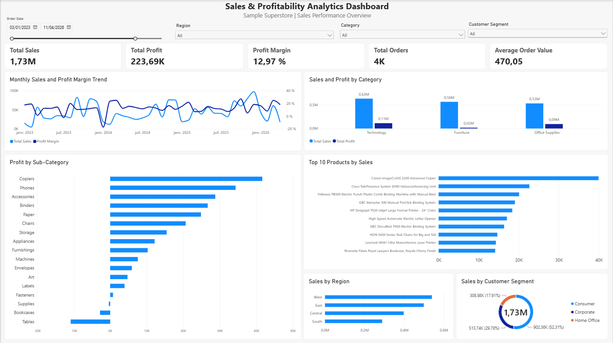
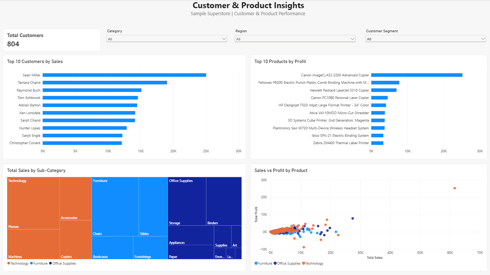

# Sales & Profitability Analytics Dashboard

## Overview

Interactive Power BI dashboard built with the **Sample Superstore** dataset to analyze sales performance, profitability, customer behavior and product performance.

The report contains two complementary pages:

- **Sales Performance Overview** — company-level KPIs, monthly trends, category / sub-category / region / segment analysis.
- **Customer & Product Insights** — top customers and products, category composition, and a sales-vs-profit diagnostic per product.

## Dashboard Pages

### Page 1 — Sales Performance Overview
- Five KPI cards: Total Sales, Total Profit, Profit Margin, Total Orders, Average Order Value.
- Filters: date range (Between slicer), Region, Category, Customer Segment.
- Monthly Sales and Profit Margin Trend (dual axis: Sales in currency, Margin in %).
- Sales and Profit by Category (clustered columns).
- Sales by Region, Top 10 Products by Sales, Profit by Sub-Category, Sales by Customer Segment (donut).

### Page 2 — Customer & Product Insights
- KPI: Total Customers (DISTINCTCOUNT of Customer ID).
- Top 10 Customers by Sales, Top 10 Products by Profit.
- Sales by Sub-Category (treemap, size = Total Sales).
- Sales vs Profit by Product (scatter chart, one point per product, colored by Category; tooltips show Product Name, Category and Profit Margin).

## Tools & Skills

- **Power BI Desktop** — report building, interactivity, formatting
- **Power Query** — data loading, type control, missing-values checks
- **DAX** — measure creation (`SUM`, `DISTINCTCOUNT`, `DIVIDE`)
- Data visualization & KPI design
- Business analysis (profitability diagnostics)

## Key Measures (DAX)

| Measure | Formula |
|---|---|
| Total Sales | `SUM('Orders'[Sales])` |
| Total Profit | `SUM('Orders'[Profit])` |
| Profit Margin | `DIVIDE([Total Profit], [Total Sales], 0)` |
| Total Orders | `DISTINCTCOUNT('Orders'[Order ID])` |
| Average Order Value | `DIVIDE([Total Sales], [Total Orders], 0)` |
| Total Customers | `DISTINCTCOUNT('Orders'[Customer ID])` |

## Key Findings

*(Values observed on the dashboard; all visuals respond to the shared filters.)*

1. **Technology leads in both sales and profit** (~0,63M sales / ~0,11M profit), followed closely by Furniture in volume (~0,56M) — but see finding 2.

2. **Furniture sells almost as much as Technology yet earns very little**: ~0,02M profit on ~0,56M sales (≈ 4% margin), versus ≈ 17% for Technology and Office Supplies. Furniture is a high-volume, low-margin category — the main profitability gap of the business.

3. **Profit margin is volatile month to month** (≈ 5% to ≈ 20%): peaks around September (~20%), sharp dips around March and mid-year. Sales volume and margin do not move together — margin deserves monitoring independently of revenue.

4. **The West region generates the most sales**, ahead of East; Central and South are close and lower. Regional volume differences are visible at a glance in the "Sales by Region" ranking.

5. **The Consumer segment dominates sales (~55%)**, ahead of Corporate (~26%) and Home Office (~19%) — the customer base is heavily skewed toward individual consumers.

6. **Best-selling products are not always the most profitable**: the Top 10 by Sales and the Top 10 by Profit (led by the Canon imageCLASS 2200 Advanced Copier) are different lists, and the Sales vs Profit scatter shows products with strong sales but weak or negative profit — a volume-vs-margin trade-off.

## Data Source

- **Sample Superstore** dataset (public demo dataset by Tableau), orders from January 2023 to April 2026.
- Fields used: Order ID, Order Date, Ship Date, Ship Mode, Customer ID, Customer Name, Segment, Region, Country/City/State, Category, Sub-Category, Product Name, Sales, Profit, Quantity, Discount.

## Screenshots

| Page 1 — Sales Performance Overview | Page 2 — Customer & Product Insights |
|---|---|
|  |  |

## Repository Structure

```
powerbi-sales-profitability-dashboard/
├── README.md
├── dashboard/
│   └── Sales_Profitability_Dashboard.pbix
├── screenshots/
│   ├── sales-performance-overview.png
│   └── customer-product-insights.png
└── docs/
    └── data-dictionary.md
```
